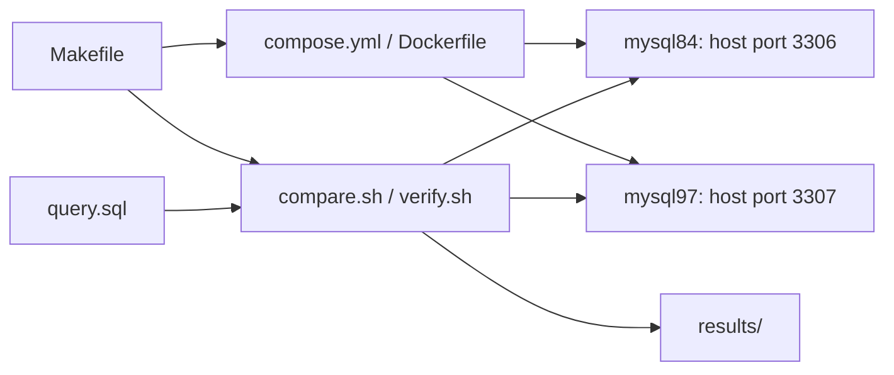

<!-- Section layout inspired by https://architecture.md/ -->
<!--
出典: ARCHITECTURE.md Template by timajwilliams (https://github.com/timajwilliams/architecture)。
archmd により節・見出し・説明を再構成し、ID マーカーと更新ルールを追加。
SPDX-License-Identifier: Apache-2.0
ライセンス全文: https://www.apache.org/licenses/LICENSE-2.0.txt
再配布時はこの表示を保持し、Apache-2.0 全文と archmd notices の出典表示を同梱する。
この表示はテンプレート・ルールに適用され、記載対象プロジェクトのライセンスは指定しない。
-->
# Architecture Overview

<!-- arch:project-structure | Project layout | Map the main directories to their responsibilities. -->
## Project layout
- `compose.yml` and `Dockerfile`: two MySQL services and their versioned base images.
- `Makefile`, `compare.sh`, and `verify.sh`: local lifecycle, optimizer comparisons, and database checks.
- `query.sql`: Sakila join and aggregation workload used by the comparison.
- `sakila-db/`: sample schema, data SQL, and MySQL Workbench model; `sakila-db.tar.gz` is the bundled archive.
- `results/`: captured execution plans and optimizer trace excerpt; root-level `result_*.txt` also contain captured output.
<!-- arch:high-level-diagram | System map | Show the system overview and connections between major components. -->
## System map

<!-- arch:core-components | Components | Describe each central module and the responsibility it owns. -->
## Components
- `compare.sh` uses the host MySQL client against both services' `sakila` databases: MySQL 8.4 defaults and MySQL 9.7 with Hypergraph disabled/enabled. It writes `EXPLAIN ANALYZE` output, a trace excerpt, and a timing summary.
- `verify.sh` checks versions and optimizer settings, recreates `verify_db.t1` for basic SQL checks, and uses `docker exec` for a MySQL 9.7 trace probe against Sakila.
- `Makefile` starts/stops services, waits for health checks in `verify` and `compare`, and removes data volumes through `clean`. Both `compare-84` and `compare-97` currently invoke the full comparison script.
- `sakila-db/sakila-schema.sql` and `sakila-db/sakila-data.sql` supply the comparison dataset. No automated import is configured; Sakila must be loaded separately into both services.
<!-- arch:data-stores | Data stores | Name persistent stores and their tables or collections without detailed schemas. -->
## Data stores
- `sakila`: `actor`, `address`, `category`, `city`, `country`, `customer`, `film`, `film_actor`, `film_category`, `film_text`, `inventory`, `language`, `payment`, `rental`, `staff`, `store`.
- `verify_db`: `t1`.
<!-- arch:external-integrations | External services | Identify outside services and the reason each connection exists. -->
## External services
- `Dockerfile` uses the official `mysql` container image with its version supplied by Compose.
<!-- arch:deployment-infrastructure | Build and deploy | Outline where the system runs and how changes reach it. -->
## Build and deploy
- Docker Compose runs `mysql84` and `mysql97` from `mysql:8.4` and `mysql:9.7`, with containers `mysql84-compare` and `mysql97-compare`.
- Named volumes `mysql84-data` and `mysql97-data` persist `/var/lib/mysql`; services publish host ports 3306 and 3307 respectively and initialize `testdb`.
<!-- arch:decisions | Key decisions | Summarize each decision and its reason in one line. -->
<!-- arch:security-considerations | Security | Summarize access boundaries and protections for sensitive information. -->
## Security
- Compose and scripts hard-code the root password `rootpass`. Published ports have no host-address restriction; scripts connect through `127.0.0.1`.
- Verification drops and recreates `verify_db`; `make clean` removes matching MySQL data volumes.
<!-- arch:dev-testing-environment | Development and testing | Name essential development tools and checks and link to setup instructions. -->
## Development and testing
- Requires Docker Compose, Make, Bash with associative-array support, the host `mysql` client, and standard shell text utilities.
- `make verify` runs database checks; `make compare` runs the workload. `SQL_FILE` and `OUT_DIR` override the comparison input and output directory.
<!-- arch:future-considerations | Roadmap and known debt | Record likely architectural changes and unresolved design constraints. -->
<!-- arch:project-identification | About this project | Identify this project, its repository and maintainers, and its last reviewed date (YYYY-MM-DD). -->
## About this project
- Local MySQL 8.4 versus 9.7 optimizer comparison harness, including Hypergraph on/off experiments using Sakila.
- Repository URL and maintainers: Not confirmed from the repository.
- Last reviewed: 2026-11-14.
<!-- arch:glossary | Glossary | Define local terminology that a new contributor needs to understand. -->
